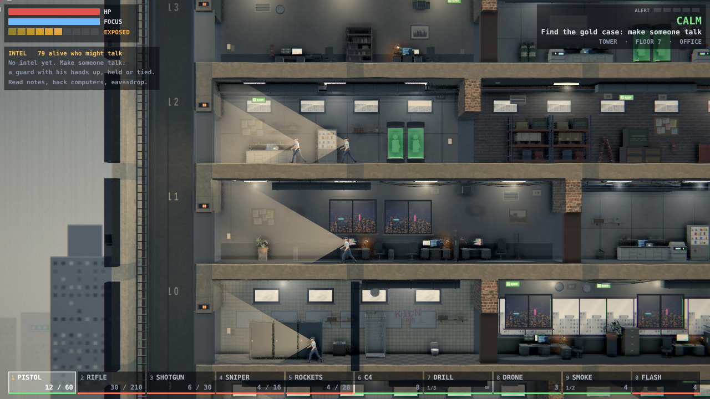
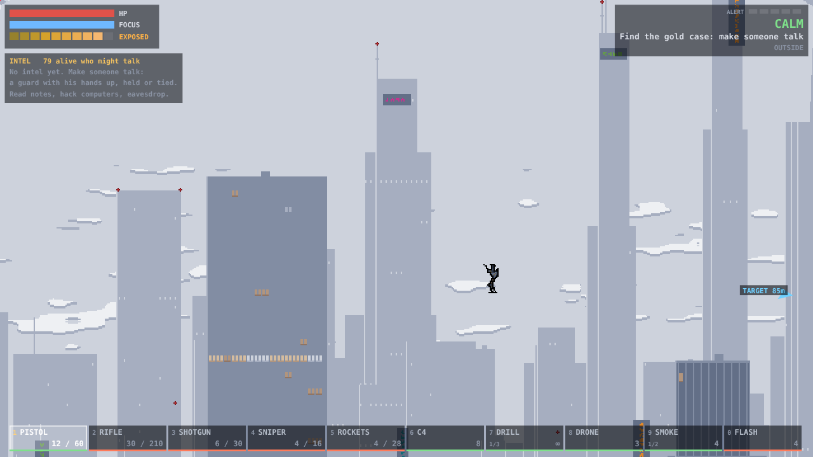
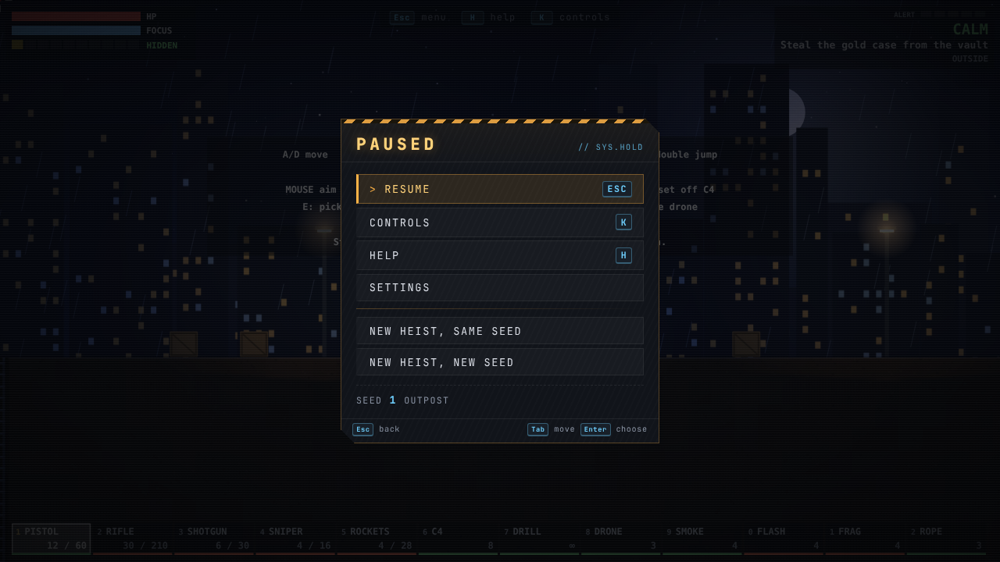
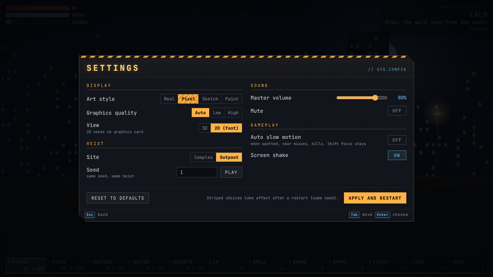
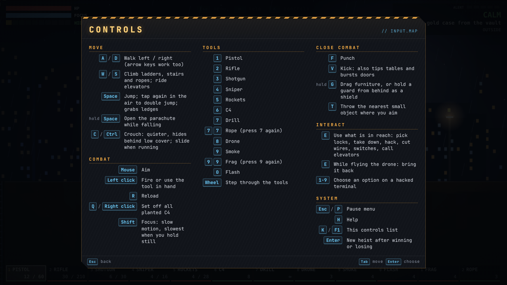
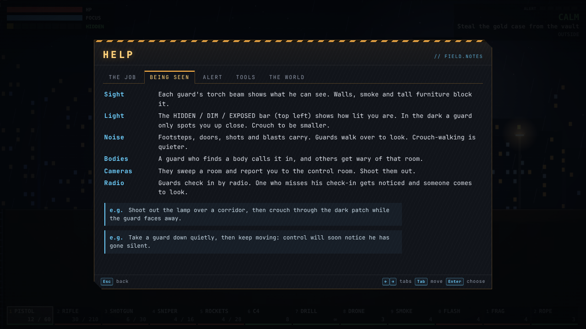
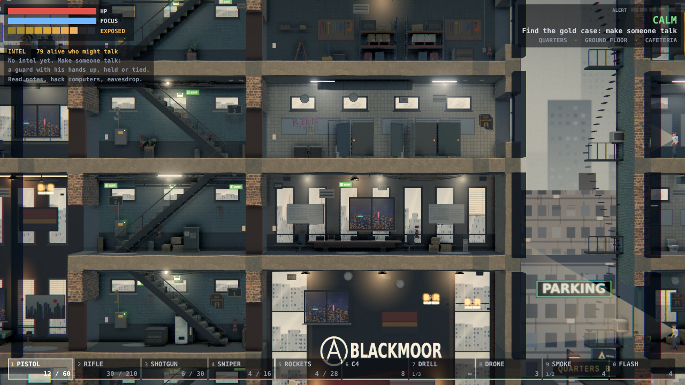
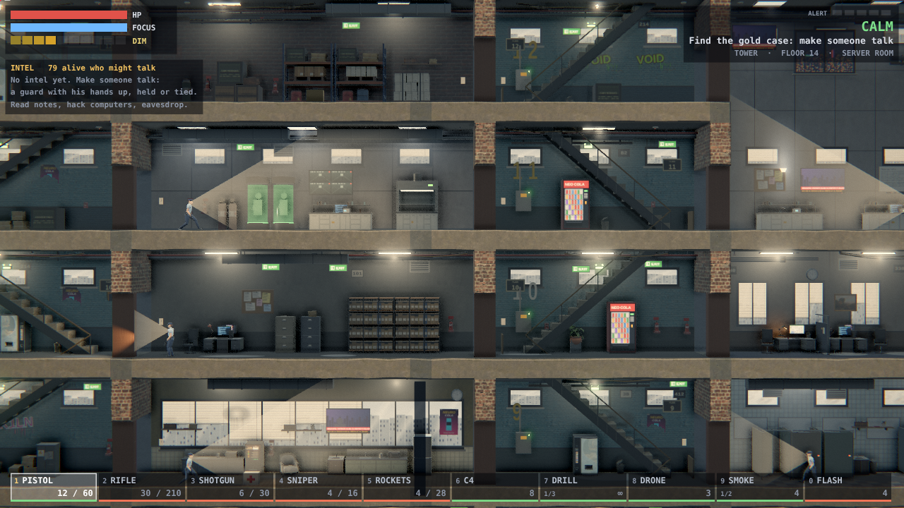
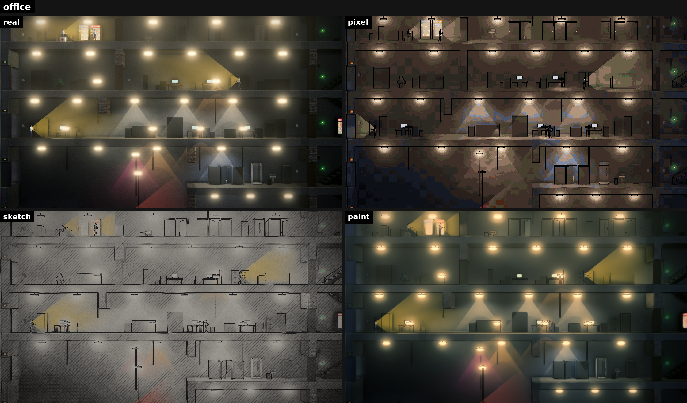
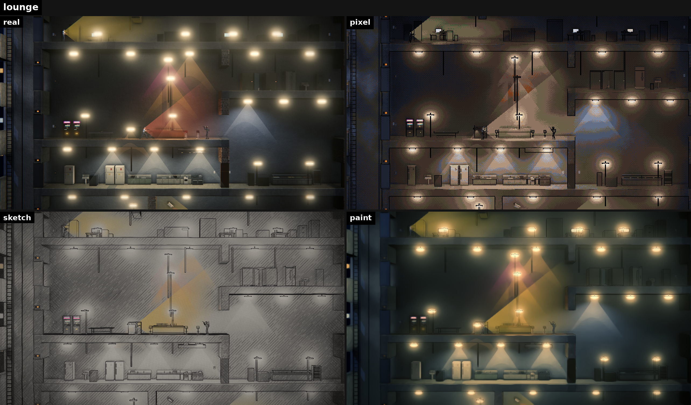

# Smash & Grab

A side-on heist sandbox. Parachute into a guarded complex, find a gold case, and get it back to the van. Go quiet or go loud: almost everything can be blown apart, and the guards react to what you do.





```
        plane drop (parachute, steer for the TARGET arrow)
                        ↓
 van   gate   depot   ┌──────────┐   quarters   silos
 ┌─┐   ┌─┐   ┌────┐   │  tower   │   ┌──────┐   ┌─┐┌─┐
 │ │ ► │ │ ► │    │ ► │ 20+ floors│ ► │      │   │ ││ │
─┴─┴───┴─┴───┴────┴───┴────┬─────┴───┴──────┴───┴─┴┴─┴─
   manhole ── sewer ── basements ── (the case is hidden somewhere)
```

## Run it

```bash
npm install
```

```bash
npm run dev
```

Checks:

```bash
npm test
```

```bash
npm run build
```

## The job

1. Drop in. Hold **Space** while falling to open the parachute.
2. Find the gold case. Nobody tells you where it is: it sits in one of several rooms (the vault, an executive safe, a lab, a store room, the armoury).
3. Carry it back to the van.

### Finding the case

| Source | How | How reliable |
|---|---|---|
| A guard who surrendered, is tied up, or is your human shield | Get close; press **E** to tie a surrendered guard, then hold **E** to question him. He must be awake; each person talks once | About 70% tell the truth. Officers know the room; rookies only know the building |
| Notice boards, whiteboards, papers | Hold **E** to read | About 90% |
| A hacked computer | "Search files for the case" | About 90% |
| Two calm guards chatting | Stay hidden nearby for a few seconds | About 90% |

Two sources that agree mark a clue as confirmed. The Intel panel lists what you know and an arrow points at the search area.

Going loud costs you: dead guards cannot talk, and once the alarm has rung for a while the guards move the case, which makes your old clues stale.

## Controls

Press **Esc** in the game for the full list, help and settings.

| Key | Action |
|---|---|
| A / D | Move |
| W / S | Climb ladders, stairs, ropes and the grapple line; ride elevators; hold S over a floor hole to drop through |
| Space | Jump. Tap again in the air to double jump. Grabs ledges |
| Hold Space while falling | Parachute |
| C or Ctrl | Crouch (quieter, hides behind low cover); slide when running |
| Mouse | Aim and use the tool in hand |
| R | Reload |
| 1-9, 0 or wheel | Pick a tool. Press 1 again for the Dart gun; 7 again for Rope, then Grapple; 9 again for Frag. On an open terminal the number keys pick an option instead |
| E | Do the thing in reach: break in through a window (tap to smash, hold to cut quietly), pick locks, take down, tie up, question, hack, cut wires, switches, call elevators |
| F / V | Punch / kick (a kick also tips tables and bursts doors) |
| G | Drag furniture (hold), hold a guard from behind as a shield (hold), pick up or drop a body |
| X | Aim a gun at a nearby guard: shout hands up. Otherwise whistle to lure a guard |
| T | Throw the nearest small object where you aim |
| Q or right-click | Set off all C4 |
| Shift | Focus: slow motion, slowest when you hold still |
| Esc or P | Pause menu |
| H / K or F1 | Help / controls |
| Enter | New heist after winning or losing |



## Tools

| Key | Tool | Quiet? | Use |
|---|---|---|---|
| 1 | Pistol | Yes | Drops unaware guards in one shot |
| 1 ×2 | Dart gun | Yes | Puts a guard to sleep a few seconds after it hits; armour stops it |
| 2 | Rifle | No | Fast fire; goes through doors |
| 3 | Shotgun | No | Nine pellets, huge up close, useless far away |
| 4 | Sniper | No | One heavy shot; goes through doors, brick and people |
| 5 | Rockets | No | Blast holes anywhere |
| 6 | C4 | Until it goes off | Sticks to walls, doors, windows and ceilings. Q sets off all of it |
| 7 | Drill | Mostly | Tunnel through anything, slowly |
| 7 ×2 | Rope | Yes | Tie it at an edge and climb the outside of the building |
| 7 ×3 | Grapple | Yes | Fire a hook at a wall or roof edge, reel with W/S, swing with A/D |
| 8 | Drone | Yes | Fly it with the move keys to scout, click to detonate, E to bring it back |
| 9 | Smoke | Yes | Blocks sight |
| 9 ×2 | Frag | No | Rolls down stairs; destroys the stair flight |
| 0 | Flash | No | Blinds and deafens anyone looking |

The crosshair ring widens as a gun gets less accurate, so spread is never a surprise.

## Staying quiet

| Option | How |
|---|---|
| Close doors | **E** closes a door you opened (crouched: silently). A picked lock closed again leaves no trace |
| Kill or choke out | Behind an unaware guard: **E** kills at once (a small sound, blood). Crouched, hold **E** to choke him out silently; he wakes in 3 minutes unless tied |
| Move bodies | **G** picks up and drops, **T** throws. While carrying, **E** hides the body in a locker, wardrobe, stall, dumpster, or under a desk or bed |
| Hide yourself | **E** at a locker, wardrobe or bathroom stall; **E** to crawl under a desk. From inside, **E** grabs a guard walking past |
| The surprise window | A lone guard who finds you up close is startled for about 3 seconds (less for veterans). Subdue him in that time and nobody hears about it |
| Disguise | Hold **E** on a body to put on his uniform. It fools guards and cameras even up close, including officers, until you do something suspicious |
| Keycards and radios | Take a keycard from a body to open keypad doors silently. Take his radio to answer his check-ins (two bluffs) |
| Lures | **X** whistles; switching on a TV or vending machine draws the nearest guard. Overuse brings them in pairs |
| Dart gun | Press **1** twice: a quiet dart that knocks a guard out after a few seconds |
| Cameras and power | Loop a camera from a terminal for 90 seconds; crouch + hold **E** on a fuse box to make it trip 20 seconds later |

The top-left HUD says why you are or are not seen (IN DARKNESS, IN COVER, DISGUISED, NOISY), and the end screen rates the run: Ghost, Silent or Loud.

## Things the world lets you do

- Shoot out lamps, cameras, alarm buttons, radio relays and fuse boxes.
- Cut the power at a fuse box, or the radios at a relay. Guards then have to walk to a button or the fuse box.
- Hack computers to switch off cameras and lights, unlock doors, jam radios or trigger a false alarm.
- Push a desk against a door to block it, or under a hole in the ceiling to climb up.
- Kick a table over for cover. Kick a guard off a ledge or through a window.
- Blow up a stair flight or cut an elevator cable to stop guards following.
- Destroy the whole floor under something and it falls. Cars catch fire and explode.
- Shoot fuel drums and gas cylinders. Fire spreads, smoke fills rooms, sprinklers answer.
- Rooms have depth even though the view is side-on. You walk past holes in the floor, elevator shafts, hatches and low rubble; hold S to drop into one.
- A blast only removes what it destroys: the floor and ceiling around the hole stay. A storey comes down, in one piece, only when nothing is left holding it.
- Blow the legs off a watchtower and it falls.
- Swing on the grapple and crash through a window.
- Climb floors the loud way: throw C4 up onto the ceiling, set it off, fire the grapple through the hole, reel up with W and let go. You land on the floor above; hold S to drop back.

## Every night is different

- **Tonight's conditions.** Each seed picks two or three, shown at the start and in the pause menu: rain or a storm, backup power, a skeleton crew or a VIP visit, a shift change, a delivery, scaffolding on the tower, a fire drill, a party, an inspection, a rival crew.
- **Events during the heist.** A smoke break, a blackout, the control-room operator called away, two guards chatting near you, a floor-by-floor fire evacuation, a surrendered guard offering a deal. Each is announced by a radio line or a guard speaking.
- **Guards are people.** They have names, traits (jumpy, lazy, night-blind, greedy, clumsy), friends and rivals. They remember what you did, and one or two survivors return in later heists. The pause menu's Dossier lists the ones you have met.
- **The story afterwards.** The game writes up what happened as a short news report with a headline, a verdict and highlights. Past heists are kept in the pause menu.

## Chain reactions

| Cause | What follows |
|---|---|
| Shoot a pipe, sink, tank or hydrant | Water pools, pours through holes, puts out fires, shorts electronics, floods basements. Wet floors are slippery and loud |
| Water reaches a live rack or a dangling cable | The puddle shocks anyone in it, then the breaker trips and the lights go out |
| A gas leak | Gas rises through holes; a light switch upstairs can set it off |
| Open a sealed, smoke-filled burning room | Backdraft |
| Shoot a car or fuel drum | Fuel leaks, flame runs along the trail, the tank cooks off |
| A long fire | Burns through the floor, cracks glass, leaves doors too hot to touch |
| Shoot a ceiling fan, sign or chandelier | It falls on whoever is below |

**E** opens taps and valves, loosens gas fittings and releases handbrakes, so you can set these up on purpose.

## The guards

| They notice | What happens |
|---|---|
| A small sound | One guard comes to look |
| A body, an open door, a picked lock, a dead camera, a rope | They radio it in and search in pairs |
| Gunfire | They aim at where it came from, take cover and shoot back, even through a floor hole |
| An explosion | The armoured response team drives in and the site locks down |

- The site alert rises in steps from 0 to 4 and is shown at the top right.
- Each guard is a rookie, regular or veteran. Scared guards refuse to enter a room alone, fire blind from cover, fall back, hide or surrender.
- In a fight they split up: some pin you down while others come round by another stairwell.
- A spot where guards died becomes a kill zone. They flashbang it first, and after enough deaths a four-man shield team comes through.

## Screens

| | |
|---|---|
|  |  |
|  |  |
|  |  |

## Art styles

Pixel is the default. Pick another in Settings (it switches at once) or add `?look=real`, `pixel`, `pixel-hd`, `sketch` or `paint` to the address.



## Options

Settings are in the pause menu and are remembered. The same things can be set in the address:

| Add | Effect |
|---|---|
| `?seed=1` | Replay the same heist. Even seeds flip the site left to right |
| `?site=outpost` | A small site instead of the big complex |
| `?quality=low` or `?quality=high` | Fewer or more graphics effects (default adjusts itself) |
| `?render=2d` | A flat view that needs no graphics card (also used when 3D cannot start) |
| `?debug=1` | Publishes drawing counters on `globalThis.__renderInfo` |

## Code layout

| Folder | What it holds |
|---|---|
| `src/game/` | The whole game with no browser code. `world.ts` is the state, `step.ts` advances one frame |
| `src/game/complex/`, `furnish/` | The site generator: buildings, rooms, furniture, lights, ducts |
| `src/game/security/` | Guards: senses, nerve, tactics, radio, dispatcher, shield team |
| `src/game/hazards/`, `ballistics/`, `frag/`, `collapse.ts` | Fire, smoke, grenades, bullets through walls, falling structure |
| `src/game/physprops/`, `melee/`, `rope/`, `grapple/`, `gaps/` | Furniture you can move, close combat, ropes, the grapple, floor holes |
| `src/game/intel/` | The hidden case and the clues that find it |
| `src/render3d/` | The 3D view (three.js): level, lights, props, people, effects |
| `src/render/` | The HUD, markers over both views, the shared skeleton, the flat fallback view |
| `src/ui/` | Menus (pause, controls, help, settings, past heists, dossier), the loading screen, tonight's card, the weather over the view, the debrief |
| `docs/` | Design references and research notes |

Everything in `src/game/` is deterministic and covered by tests (`npm test`).

## Credits

- Textures, skies, most models and sounds are public domain (CC0); sources are listed in `public/textures/LICENSE.md`.
- The furniture models in `public/models2/` are CC BY 4.0 and credited in `public/models2/CREDITS.md`.
- Design references are listed in `docs/REFERENCES.md`.
