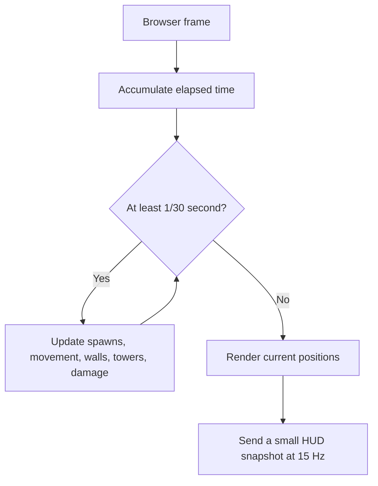

# Orcfall Command — Game & Technical Specification

Status: living specification, version 0.1  
Genre: incremental horde tower defense  
Camera: top-down orthographic 3D with a slight tilt  
Reference: the public descriptions and media for [Sir, We Have an Orc Problem](https://impress.games/press-kit/mumpitz-games/sir-we-have-an-orc-problem) and its [Steam page](https://store.steampowered.com/app/4594150/Sir_We_Have_an_Orc_Problem/)

This is an original game which targets the reference's broad mechanical appeal: overwhelming crowds, automated defenses, pre-battle planning, active battlefield powers, and persistent incremental upgrades. It does not copy the reference's title, art, audio, writing, exact maps, icons, or interface.

## 1. Player fantasy and design pillars

The player commands a small fortress facing an absurdly large orc army. A run alternates between deliberate preparation and spectacular automated combat.


The design pillars are:

1. **A visible flood.** Orcs behave like a crowd, compressing at bends and walls instead of forming a neat queue.
2. **Plan first, react later.** Towers are placed only during preparation. Combat decisions come from limited active powers.
3. **Readable spectacle.** Tracers, explosions, ice, knockback, and corpses are dramatic without hiding the route, base, or cooldowns.
4. **Every run matters.** Win or lose, the player earns permanent medals.
5. **Large but understandable growth.** A 60-node tree unlocks new tools and improves clear stats.
6. **Fast iteration.** Maps and balance values are editable through built-in developer tools.

## 2. Run structure

### 2.1 Loadout

Before a run, choose up to four tower types and three active powers. A later commander-doctrine slot supplies one passive rule change.

### 2.2 Preparation

The player receives a fixed supply budget. They can place, move, aim, or refund towers and starting field walls. The interface shows range, valid ground, cost, and incoming enemies. Starting combat locks all conventional construction.

Rules:

- Towers must be on buildable ground and cannot overlap.
- Starting walls must touch the route and cannot cover spawn or fortress zones.
- The player cannot spend more than the current supply budget.
- Selling during preparation refunds the full cost.
- At least one damaging tower is required to begin.

### 2.3 Combat

Orcs enter continuously in waves. Towers acquire targets and fire automatically. The player may pause, select 1× or 2× speed, inspect statistics, and cast equipped powers. Normal towers cannot be placed, moved, sold, or upgraded.

Temporary walls are the one construction exception: they are an equipped combat power with charges, cooldown, health, and a lifetime. If a wall creates a reasonable detour, orcs flow around it; otherwise nearby orcs attack it.

### 2.4 Results

Show victory/defeat, survival time, waves, kills, leaks, fortress health, damage by source, medals earned, best run, and newly available upgrades. Both victory and defeat award medals.

Example medal formula:

```text
medals = max(1, floor(kills / 4)) + wavesCleared * 4 + victoryBonus + difficultyBonus
```

Repeatedly farming an early map receives diminishing bonus rewards but never zero rewards.

## 3. Battlefield rules

Each map contains one or more spawn areas, a fortress, a walkable route network, free-build terrain or pads, impassable terrain, and optional secondary objectives.

For the first few hundred enemies, a polyline route is sufficient. At larger scale, maps use a navigation grid and a flow field pointing toward the fortress. Nearby enemies apply small separation forces so the horde spreads naturally. Temporary walls trigger a rate-limited flow-field rebuild. An invalid full blockade causes orcs to attack the blocking wall.

The fortress has visible health, a damage flash, and optional shield. Orcs reaching it attack or deal leak damage. A run ends at zero health.

Wave data controls enemy composition, count, entry lane, spawn interval, health multiplier, speed multiplier, reward multiplier, and boss presence. Maps should run 8–15 minutes in the finished game.

## 4. Tower roster

All tower definitions share: cost, range, damage, shots per second, projectile speed, targets, targeting rule, damage type, splash radius, and modifiers.

| Tower | Main role | Example variants |
|---|---|---|
| Rivet Gun | Cheap rapid single-target damage | Twin barrel, armor piercing, suppressive |
| Heavy Gun | Sustained cone with spin-up | Incendiary, shredder, stabilized |
| Cannon | Slow penetrating or explosive shells | Cluster, siege, shrapnel |
| Rocket Battery | Long-range area damage with minimum range | Swarm, bunker buster, napalm |
| Flamethrower | Short cone and burn | Wide cone, sticky fuel, blue flame |
| Cryo Projector | Slow and freeze buildup | Chain freeze, brittle, blizzard pulse |
| Tesla Coil | Chain damage through dense groups | More chains, stun, overload |
| Laser | Continuous ramping elite damage | Piercing, split beam, heat burst |
| Mortar | Large arcing splash | Cluster, stun, corrosive |
| Support Beacon | Nearby tower buffs | Fire rate, range, damage, cooldown |

Targeting choices eventually include first, closest, strongest, weakest, and densest cluster.

## 5. Orc roster

| Orc | Behavior |
|---|---|
| Grunt | Baseline health, speed, and fortress damage |
| Runner | Low health and high speed |
| Brute | Slow, high health, heavy wall/base damage |
| Shieldbearer | Reduces frontal ballistic damage |
| Armored Orc | Resists bullets; weak to explosive or piercing damage |
| Shaman | Buffs nearby speed or resistance |
| Banner Carrier | Buffs nearby attack damage and morale |
| Sapper | Prioritizes walls and deals bonus wall damage |
| Berserker | Accelerates as health falls |
| Ogre | Boss health, knockback resistance, heavy base damage |

Enemy definitions are data, not separate hard-coded components. New behavior is implemented only when a type genuinely needs a new rule.

## 6. Damage and status rules

Damage types: ballistic, explosive, fire, cryo, electric, and energy.

Statuses:

- Burn: damage over time.
- Slow: reduced movement speed.
- Freeze: temporary immobility.
- Brittle: increased explosive damage.
- Shock: brief interruption or increased chain damage.
- Armor break: reduced armor for a duration.

The first playable layer uses raw damage only. Resistances and combinations arrive with the matching towers and enemies.

## 7. Active powers

- **Aircraft Strafe:** draw a line; after a short warning, repeated impacts damage and lightly knock back all enemies in the lane.
- **Cryo Beam:** drag a line or sweep a beam; applies slow and freeze buildup.
- **Tactical Nuke:** large target circle, long warning, extreme center damage, knockback, one charge or very long cooldown.
- **Artillery Barrage:** several less predictable impacts inside a selected circle.
- **Orbital Laser:** guide a small high-damage area for several seconds.
- **Emergency Repair:** restore fortress health; one or two charges.
- **Temporary Wall:** place a destructible short barrier during combat. Upgrades add health, length, spikes, break explosion, lifetime, and charges.

Power targeting always shows its area and whether the target is valid. Cooldown-ready state has both visual and audio feedback.

## 8. Content maps

1. **The Green March:** one broad bending route and open central ground. Its five teaching waves introduce Grunts, Runners, Shieldbearers, then Brutes without lane-specific pressure.
2. **Twin Fork:** two mirrored spawn lanes merge late. Every wave sends authored pairs down both lanes, rewarding splash coverage before adding Sappers and Brutes.
3. **Frozen Pass:** one narrow switchback through icefall boulders with four marked firing pockets. Dense Shieldbearer, Armored, Brute, and Shaman waves test focused choke defense.
4. **Ash Fields:** one unusually wide route crosses scattered volcanic rubble. Armored Orcs screen overlapping Sapper, Berserker, Banner, and Brute pressure.
5. **Broken Citadel:** three separate approaches converge on one fortress, while only five small build zones remain usable. The final mixed assault ends with one Ogre on the center lane.

Campaign missions own distinct five-wave sets; they do not all reuse the standard Sandbox/challenge waves. Counts, timing, composition, and lane assignment escalate within each operation while remaining ordinary `WaveDefinition` data.

The built-in Map Forge edits the same `MapDefinition` used by battle code. Initial controls create an ordered route whose first point is spawn and last point is fortress. Expansion controls add lanes, terrain stamps, build zones, a defendable supply-cache objective, decorations, wave sets with boss and reward metadata, validation, JSON import/export, and a saved map library.

## 9. Meta progression: 60 nodes

Ten branches contain six nodes each. Stat nodes can have multiple ranks. Save data stores node IDs and ranks, never derived totals.

| IDs | Branch | Nodes in order |
|---|---|---|
| 1–6 | Gunner | Unlock; damage; fire rate; range; armor piercing; twin barrel |
| 7–12 | Explosives | Cannon; explosive damage; splash; projectile speed; cluster shell; Rocket Battery |
| 13–18 | Fire | Flamethrower; burn duration; fire damage; cone width; sticky fuel; spread on death |
| 19–24 | Cryo | Cryo Projector; slow; freeze buildup; freeze duration; brittle; chain freeze |
| 25–30 | Energy | Tesla; chain target; electric damage; stun; Laser; piercing beam |
| 31–36 | Artillery | Mortar; splash; fire rate; lower minimum range; stun shell; cluster mortar |
| 37–42 | Command | supply; refund; fourth tower slot; Support Beacon; aura; fortress shield |
| 43–48 | Air Support | Strafe; extra charge; lane width; damage; cooldown; armor break |
| 49–54 | Strategic | Barrage; extra salvo; Cryo Beam; frozen ground; Nuke; fallout |
| 55–60 | Fortification | Temporary walls; health; charge; length; spikes; break explosion |

Major unlocks cost more than small stat nodes. Prerequisites remain visible. Early development allows a free full respec. A versioned save migration protects progress when balance changes.

## 10. Game modes

- **Campaign:** maps unlock in order with difficulty tiers.
- **Endless:** difficulty rises forever; score uses time, waves, kills, and remaining health.
- **Challenges:** later modifiers such as no powers, explosives only, walls only, double speed, one-health fortress, or limited slots.

## 11. Input and accessibility

Preparation: left click place/select, right click or Escape cancel, drag move, `R` rotate, Delete refund, Space start.

Combat: `1–3` select power, click/drag target, Space pause, Tab statistics, `+/-` speed. Backtick opens developer tuning.

Settings include master/effects/music volume, screen shake, corpse density, reduced flashes, color-independent placement markers, UI scale, pause on focus loss, and later key rebinding.

## 12. Art and audio direction

The game looks like a field-command diorama: muted grass, earth, timber, iron, canvas, smoke, and warning red; stylized low-poly units; exaggerated recoil and shell arcs; strong green-orc, warm-fire, cyan-cryo, and orange-strategic contrast. UI resembles stamped field manuals, command boards, brass fittings, and military stencils.

Use original models and layouts. `img2threejs` may later help generate one distinctive hero object from a clean isolated reference, such as an aircraft, boss, or command tower. Ordinary swarm units remain deliberately low-poly and instanced.

Audio uses a restrained battle loop, punchy weapon and impact layers, distinct UI sounds, and unmistakable ability-ready cues. No important state is communicated only through audio or color.

## 13. Technical architecture

Stack: React, TypeScript strict mode, Three.js through React Three Fiber, plain CSS, Vitest, and versioned localStorage. No Tailwind or shadcn.

React owns menus, HUD, editors, results, save data, and coarse snapshots. Mutable simulation data stays inside the scene and advances on a fixed 30 Hz step. Rendering can run at a different frame rate.



Current module boundaries:

```text
src/game/config.ts       content defaults
src/game/types.ts        shared narrow data shapes
src/game/path.ts         pure route math
src/game/save.ts         versioned progression save
src/game/mapStore.ts     editable map persistence and validation
src/game/tuningStore.ts  live balance persistence
src/components/          scene, HUD/editor panels
```

At several thousand enemies, replace one-render-object-per-orc with `InstancedMesh`, typed arrays for hot fields, spatial hashing for target queries, pooled tracers/effects, and flow-field navigation. Optimize only after profiling identifies the boundary.

## 14. Prototyping tools

### Map Forge

- Edits and saves one or more battle-ready routes.
- Shows spawn, bend, and shared fortress points, with fortress snapping between lanes.
- Places validated blocking boulders and prevents tower overlap.
- Supports undo, clear, reset, naming, immediate play, and JSON import/export.
- Places optional circular build zones, chooses terrain presets, and authors compact wave/group data—including health, speed, damage, reward, and boss metadata—for Sandbox.
- Keeps a versioned multi-map library with legacy migration, isolated corruption recovery, duplicate/rename/delete/edit/play controls, and reload-safe selection.

### Live Combat Tuning

- Searches and edits supply, tower cost/damage/range/fire rate, orc health/speed/fortress damage/wall damage, and wall cost/health/collision size.
- Saves immediately and offers Apply & Restart.
- Provides a session-only Unlock All Content switch for fast prototyping without corrupting ranked progression.
- During combat, injects an unranked 500- or 1,500-Grunt diagnostic horde without changing authored wave totals.
- Power cooldown/damage/area values, fortress invulnerability, and per-type spawn controls are live now. Authored wave counts/rates belong to Map Forge; effect-scale tuning and entity inspection remain optional future tools. Live fixed-tick telemetry is exposed to browser devtools.

### Current implementation status

- Stages 1–7 are complete and playable.
- Stage 8 includes the full tower/enemy roster, five maps, six active powers plus walls, 60 implemented research nodes, sequential campaign unlocks, endless scaling, and six challenges.
- Stage 9 includes flow-field wall detours, spatially indexed combat queries, interpolated instanced crowds, pooled tracers/effects/corpses, independently scheduled overlapping wave groups, 500/1,500-enemy stress controls, generated combat audio, saved accessibility settings, UI scaling, reduced-flash visuals, contextual onboarding, and campaign pacing estimated at 8–10 minutes. Balance remains easy to iterate through tuning and Map Forge.

## 15. Playable implementation stages

Every stage must build, run, and remain playable before the next stage begins.

### Stage 1 — Core defense loop

One map, Rivet Gun, Grunt, five waves, fortress health, setup-only placement, breakable starting wall, victory/defeat, restart.

### Stage 2 — Persistence and run control

Versioned local save, medals on win/loss, best run, pause/resume, 1×/2× speed, keyboard control.

### Stage 3 — Map Forge

Edit multi-lane routes, boulders, circular build zones, terrain presets, and wave groups; validate and save multiple maps, then immediately play the authored Sandbox run.

### Stage 4 — Tuning overlay

Edit core metrics, persist them, apply with a quick restart, and keep battle code driven by the same narrow tuning object.

### Stage 5 — First active tactics

Aircraft Strafe plus combat-deployed temporary wall charges. Add fixed-step targeting previews and cooldowns.

### Stage 6 — First progression slice

Six connected Gunner nodes, purchases, visible effects on the next run, respec, and migration tests.

### Stage 7 — Combat variety

Cannon, Flamethrower, Cryo; Runner, Brute, Shieldbearer; second map; status effects; statistics.

### Stage 8 — Full arsenal and meta game

All towers, orcs, powers, maps, variants, full 60-node tree, difficulty tiers, endless, challenges.

### Stage 9 — Scale and polish

Instanced crowds, flow fields, thousands of enemies, effects, audio, accessibility, onboarding, balance.

## 16. Acceptance criteria

The first vertical slice is accepted when:

- Valid/invalid placement and range are readable.
- Towers cannot be edited after combat starts.
- Five waves can end in victory; leaks can cause defeat.
- Towers automatically damage and kill Grunts.
- Walls stop nearby Grunts, take damage, and break.
- Pause stops the simulation and cooldown time; 1×/2× changes it safely.
- Win and defeat award persistent medals; broken/old save data does not crash.
- Map Forge output is playable by the same simulation.
- Tuning changes persist and apply after restart.
- Restart never duplicates timers, enemies, towers, or input handlers.
- Desktop 16:9 and narrow layouts remain usable.

Full MVP adds aircraft strafe, combat wall charges, six upgrade nodes, a title/map flow, damage statistics, and basic generated sound effects.

Performance targets are 60 FPS with 500 Grunts and at least 30 FPS with 1,500 on a typical recent laptop after instancing is introduced.

## 17. Manual QA checklist

- [ ] Place and reject towers in the correct terrain.
- [ ] Undo and clear before battle.
- [ ] Confirm all tower editing locks during battle.
- [ ] Complete five waves and reach victory.
- [ ] Allow leaks and reach defeat.
- [ ] Pause/resume repeatedly without time jumps.
- [ ] Switch 1×/2× during a large wave.
- [ ] Place a wall and observe blocking, damage, and destruction.
- [ ] Reload and confirm medals, best run, map, and tuning persist.
- [ ] Build and save a new route in Map Forge, then play it.
- [ ] Change every tuning field and apply it with a quick restart.
- [ ] Restart repeatedly without duplicated entities or listeners.
- [ ] Resize the browser and confirm controls remain usable.
