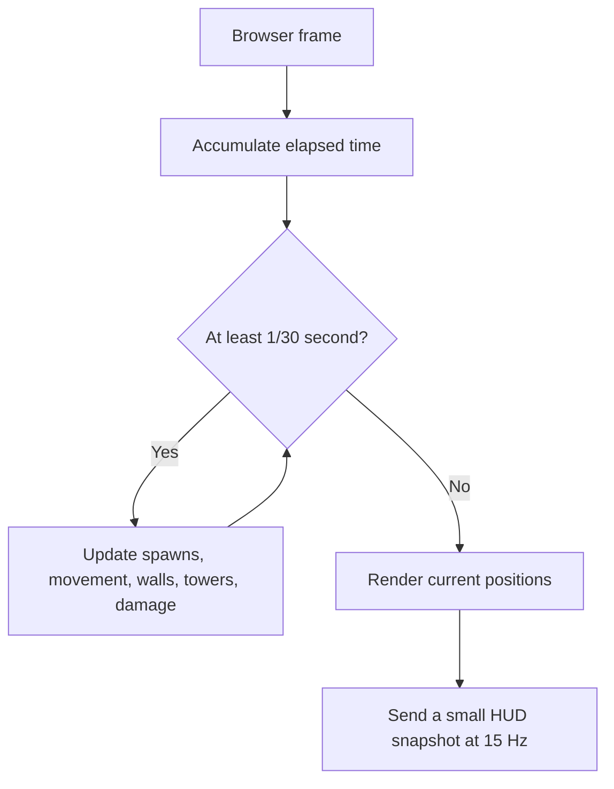

# Orcfall Command — Game & Technical Specification

Status: living specification, version 0.1  
Genre: incremental horde tower defense  
Camera: top-down orthographic 3D with a slight tilt  
Reference: the public descriptions and media for [Sir, We Have an Orc Problem](https://impress.games/press-kit/mumpitz-games/sir-we-have-an-orc-problem) and its [Steam page](https://store.steampowered.com/app/4594150/Sir_We_Have_an_Orc_Problem/)

This is an original game which targets the reference's broad mechanical appeal: overwhelming crowds, automated defenses, pre-battle planning, active battlefield powers, and persistent incremental upgrades. It does not copy the reference's title, art, audio, writing, exact maps, icons, or interface.

## 1. Player fantasy and design pillars

The player commands a small fortress facing an absurdly large orc army. A run alternates between deliberate preparation and spectacular automated combat.


The design pillars are:

1. **A visible flood.** Orcs behave like a crowd, compressing at bends and walls instead of forming a neat queue.
2. **Plan first, react later.** Towers are placed only during preparation. Combat decisions come from limited active powers.
3. **Readable spectacle.** Tracers, explosions, ice, knockback, and corpses are dramatic without hiding the route, base, or cooldowns.
4. **Every run matters.** Win or lose, the player earns permanent medals.
5. **Large but understandable growth.** An 83-node tree separates tool, profile, doctrine, power, and stat decisions.
6. **Fast iteration.** Maps and balance values are editable through built-in developer tools.

## 2. Run structure

### 2.1 Loadout

Before a run, choose up to four tower types and three active powers. Each equipped tower family also chooses one firing profile for that level: Standard or one of its two permanently researched special variants. Standard is always available, so researching a special variant never forces the player to use it. One Commander Doctrine passive may also be equipped. Forward Supply, Lean Logistics, Rapid Response, and Bastion Reserve unlock from their matching Command research nodes and respectively change starting supply, setup prices, power cooldowns, or fortress/wall durability.

### 2.2 Preparation

The player receives a visible starting supply budget. Every tower and starting wall has a visible supply price. The player can place, move, aim, or refund defenses before the horn; moving is free, while sell, undo, and clear return 100% of the setup price. Starting combat locks all conventional construction.

Tower placement uses two clicks:

1. Click valid ground to anchor the tower base.
2. Move the pointer to aim the weapon. Its full distance sector, inner dead zone when relevant, and facing follow the pointer.
3. Click again to lock the facing. A weapon can acquire targets only within half of its firing angle to either side of that direction.

All placed towers keep a faint range sector visible during preparation, with the selected tower and current preview emphasized. Weapon arcs are normally 30–60 degrees; Support Beacon remains a 360-degree aura. Legacy layouts without a facing receive a deterministic direction toward the nearest fortress endpoint. Tower bodies and previews use a compact half-scale footprint; spacing follows that visible footprint with slight overlap tolerance and smaller road, terrain, platform-edge, and map-edge buffers.

Rules:

- Towers must be on buildable ground and cannot overlap.
- Starting walls must touch the route and cannot cover spawn or fortress zones.
- The player cannot spend more than the current supply budget.
- Selling during preparation refunds the full cost.
- At least one damaging tower is required to begin.
- Each map keeps one persistent preparation layout. Challenges use separate layouts even when they share the same underlying map.
- A layout includes its tower/power loadout, permanent tower and starting-wall positions, facing, targeting, and per-tower-family variant choices. Temporary combat walls and destroyed battle state are never saved.
- Restarting, changing maps and returning, or reloading restores the saved layout. Invalid, locked, or overlapping placements are safely skipped. Over-budget defenses remain visible so the player can choose what to sell before starting.

### 2.3 Combat

Orcs enter continuously in waves. Each spawn tick emits a road-width rank rather than one overlapping orc: narrow routes fit two abreast, Green March fits three, Ash Fields fits four, and open fields distribute ranks across the usable entrance edge. Weapon towers acquire targets only when an enemy is both within distance and inside the tower's locked firing sector. Support auras remain omnidirectional. The player may pause, select 1× or 2× speed, inspect statistics, cast equipped powers, or confirm surrender. Normal towers cannot be placed, moved, sold, or upgraded.

Temporary walls are the one construction exception: they are an equipped combat power with charges, cooldown, health, and a lifetime. If a wall creates a reasonable detour, orcs flow around it; otherwise nearby orcs attack it.

Combat feedback is layered but restrained. A tower recoils and flashes at the muzzle, and its pooled tracer begins at the same measured barrel-tip position. Ballistic shots use bright yellow/orange lines; energy and status weapons retain readable family colors. A heavy projectile follows a weapon-specific arc, the impact emits a bounded spark burst and force, and a killed orc leaves a readable corpse. These are instanced pools with fixed budgets rather than independent React or ECS entities. Corpses have a separate history budget so rapid gunfire cannot erase them prematurely.

Battlefield identity must not rely on color alone. Every tower family has a recognizable weapon silhouette, and each equipped special profile adds visible hardware such as a drum, muzzle brake, shell rack, fuel tank, crystal, lens, turbine, or shield array. The placement ghost renders that actual family/profile model. Enemy roles use scale or shape-coded equipment: shields, plate shells, spirit orbs, banners, bomb packs, rage horns, and an Ogre boss ring/health bar. Powers combine a stable family color with a different target mark: aircraft, shells, snowflake, radiation rings, beam, or repair cross.

Every active enemy status is visible and simultaneous states remain layered. Burning uses an orange flame, slow a cyan ground ring, freeze an ice cage, stun a yellow rotating halo, brittle a violet shard, and armor break a red broken-shell marker. These use six fixed-capacity instanced meshes supporting the full 8,192 rendered-orc ceiling without creating per-orc React objects. Bleeding is not a current combat mechanic. Devtools can spawn one long-lived example of every implemented status for rapid visual checks.

Knockback is an impulse that decays over several fixed steps. Its strength comes from weapon data, blast falloff, upgrades, and variants; heavy units and Ogres resist it. Each impulse advances in small navigation-grid-tested steps and may slide along a blocker, but it cannot tunnel through a terrain polygon, map boundary, or temporary wall.

### 2.4 Results

Show victory/defeat/ordered retreat, survival time, waves, kills, leaks, fortress health, damage by source, Command Medals earned, best run, and newly available upgrades. Campaign progress awards one base medal per percentage point of the map's total horde eliminated. A map's first successful clear adds 50 medals. Once that map has been completed, all later elimination and objective rewards from it are paid at 50%; the one-time clear bonus is not repeated. Difficulty bonuses are calculated after those adjustments. Surrender preserves elimination medals already earned, but grants no first-clear or intact-objective bonus.

Example medal formula:

```text
eliminationPercent = floor(100 * enemiesKilled / totalMapEnemies)
firstClearMedals = wonForFirstTime ? 50 : 0
replayRate = mapWasAlreadyCompleted ? 0.5 : 1
medals = floor((eliminationPercent + objectiveBonus) * replayRate) + firstClearMedals + difficultyBonus
```

A full first clear pays 150 base medals before objectives or difficulty, while a full replay pays 50. That scale normally buys at least two early or mid-cost research upgrades after a level, keeping each result meaningful.

## 3. Battlefield rules

Each map contains one or more spawn areas, a fortress, walkable terrain, buildable terrain or pads, impassable terrain, and optional secondary objectives. Corridor maps constrain ordinary movement to the painted road; a narrow local shoulder opens only beside a temporary wall so orcs can detour around it. Crowd separation is checked against that same navigation field, so a dense horde cannot be pushed into the grass. Open-field maps make the whole field walkable except for arbitrary solid polygons: platform polygons accept towers while still blocking orcs, and blocker polygons reject both.

For the first few hundred enemies, a polyline route is sufficient. At larger scale, maps use a navigation grid and a flow field pointing toward the fortress. Nearby enemies apply small separation forces so the horde spreads naturally. Temporary walls trigger a rate-limited flow-field rebuild. An invalid full blockade causes orcs to attack the blocking wall.

The fortress has visible health, a damage flash, and optional shield. Damage persists through worn and critical stages with cracks, rubble, smoke, and a restrained critical glow. Orcs reaching it attack or deal leak damage. A run ends at zero health.

Wave data controls enemy composition, count, entry lane, rank interval, health multiplier, speed multiplier, reward multiplier, and boss presence. Rank width is derived from the authored road width; an open map uses nearly its full entrance depth. Maps should run 8–15 minutes in the finished game.

Orcs use phase-offset procedural stride, bob, lean, and head sway on the existing instanced meshes; freeze and stun stop the stride. Ogres add a pulsing ground marker and world-space health bar without leaving the instanced crowd pipeline.

The orthographic camera automatically fits each map and supports bounded wheel/button zoom plus right- or middle-button field dragging. FIT resets zoom and pan. Fortress shake offsets the camera rig instead of owning it, so shake never resets the player's view. A dragged right click is consumed as camera input while a stationary right click still cancels targeting. Pointer targeting is raycast in world space, and all gameplay continues simulating outside the visible camera bounds.

## 4. Tower roster

All tower definitions share: cost, outer range, firing angle, damage, shots per second, projectile speed, targets, targeting rule, damage type, splash radius, and modifiers. Rocket Battery and Mortar also have a minimum range. Live tuning can adjust every firing angle, and selected research nodes widen the angle.

| Tower | Main role | Firing angle | Selectable profiles |
|---|---|---|---|
| Rivet Gun | Cheap rapid single-target damage | 45° | Standard, Armor Piercer, Rapid Feed |
| Heavy Gun | Sustained automatic fire | 40° | Standard, Anti-Armor, Siege Feed |
| Blast Cannon | Slow explosive shells | 45° | Standard, Hypervelocity, Cluster |
| Rocket Battery | Long-range splash with a close dead zone | 35° | Standard, Guided, Salvo |
| Flame Thrower | Short cone and burn | 55° | Standard, Napalm, Funeral Pyre |
| Cryo Projector | Slow and freeze buildup | 50° | Standard, Brittle, Chain Freeze |
| Tesla Coil | Chain damage through dense groups | 60° | Standard, Stun Coil, Overcharge |
| Laser Lance | Continuous elite damage | 30° | Standard, Piercing, Prism |
| Field Mortar | Large arcing splash with a close dead zone | 45° | Standard, Concussion, Cluster |
| Support Beacon | Nearby tower buffs | 360° | Standard, Overclock, Fortress |

Special variants are sidegrades, not simple power levels. Each substantially changes range, rate of fire, damage, area, status, chaining, piercing, or support behavior while retaining the tower family's main identity. Research makes a profile available permanently; selecting it for a level costs no medals and only one profile per tower family can be active. Unknown, locked, or wrong-family variant IDs safely fall back to Standard. The stable catalog and exact research mapping are recorded in [TOWER_VARIANTS.md](TOWER_VARIANTS.md).

Targeting choices eventually include first, closest, strongest, weakest, and densest cluster.

## 5. Orc roster

| Orc | Behavior |
|---|---|
| Grunt | Baseline health, speed, and fortress damage |
| Runner | Low health and high speed |
| Brute | Slow, high health, heavy wall/base damage |
| Shieldbearer | Reduces frontal ballistic damage |
| Armored Orc | Resists bullets; weak to explosive or piercing damage |
| Shaman | Buffs nearby speed or resistance |
| Banner Carrier | Buffs nearby attack damage and morale |
| Sapper | Prioritizes walls and deals bonus wall damage |
| Berserker | Accelerates as health falls |
| Ogre | Boss health, knockback resistance, heavy base damage |

Enemy definitions are data, not separate hard-coded components. New behavior is implemented only when a type genuinely needs a new rule.

## 6. Damage and status rules

Damage types: ballistic, explosive, fire, cryo, electric, and energy.

Statuses:

- Burn: damage over time.
- Slow: reduced movement speed.
- Freeze: temporary immobility.
- Brittle: increased explosive damage.
- Shock: brief interruption or increased chain damage.
- Armor break: reduced armor for a duration.

The first playable layer uses raw damage only. Resistances and combinations arrive with the matching towers and enemies.

## 7. Active powers

- **Aircraft Strafe:** draw a line; after a short warning, repeated impacts damage and lightly knock back all enemies in the lane.
- **Cryo Beam:** drag a line or sweep a beam; applies slow and freeze buildup.
- **Tactical Nuke:** large target circle, long warning, extreme center damage, knockback, one charge or very long cooldown.
- **Artillery Barrage:** several less predictable impacts inside a selected circle.
- **Orbital Laser:** guide a small high-damage area for several seconds.
- **Emergency Repair:** restore fortress health; one or two charges.
- **Temporary Wall:** place a destructible short barrier during combat. Upgrades add health, length, spikes, break explosion, lifetime, and charges.

Power targeting always shows its area and whether the target is valid. Cooldown-ready state has both visual and audio feedback.

## 8. Content maps

1. **The Green March:** one broad bending route and open central ground. Its five short teaching waves contain 107 enemies, delivered in three-wide ranks, and introduce Grunts, Runners, Shieldbearers, then Brutes without lane-specific pressure. Enemy fortress damage is reduced on this operation; four legally placed, well-aimed starter Rivet Guns can complete it.
2. **Twin Fork:** two mirrored spawn lanes merge late. Every wave sends authored pairs down both lanes, rewarding splash coverage before adding Sappers and Brutes.
3. **Frozen Pass:** one narrow switchback through icefall boulders with four marked firing pockets. Dense Shieldbearer, Armored, Brute, and Shaman waves test focused choke defense.
4. **Ash Fields:** one unusually wide route crosses scattered volcanic rubble. Armored Orcs screen overlapping Sapper, Berserker, Banner, and Brute pressure.
5. **Broken Citadel:** three separate approaches converge on one fortress, while only five small build zones remain usable. The final mixed assault ends with one Ogre on the center lane.
6. **Shattered Expanse:** three spawn regions feed a shared fortress across a broad open field. Nine irregular raised platforms accept towers and force the 2,244-orc campaign flood to split and rejoin; a separate blocker creates a late detour.

Campaign missions own distinct five-wave sets; they do not all reuse the standard Sandbox/challenge waves. Counts, timing, composition, and lane assignment escalate within each operation while remaining ordinary `WaveDefinition` data.

The built-in Map Forge edits the same `MapDefinition` used by battle code. It switches between corridor and open-field navigation; creates ordered spawn/fortress anchor routes; draws, moves, edits, and deletes platform or blocker polygons; and adds terrain stamps, build zones, a defendable supply-cache objective, decorations, wave sets, validation, JSON import/export, and a saved map library.

## 9. Meta progression: 83-node branching graph

Ten branches contain 83 stable cards. Save data stores node IDs and ranks, never derived totals. Each card has one clear role: stat, tower, variant, power, wall, or doctrine. Shape and a unique corner symbol communicate that role without printing category labels on every card. A stat card never also unlocks a profile. Every special profile has its own visually distinct card, and all incoming arrow requirements must be complete; profile and doctrine parents normally require maximum rank. Heavy Gun, Rocket, and Laser each have their own damage/rate or guidance/focus stat paths instead of borrowing another weapon's upgrades.

Card brightness communicates purchase state. Prerequisite-blocked cards are heavily grayed and carry a lock seal; prerequisite-ready cards that only lack medals are softly muted; currently purchasable cards receive a bright medal outline; partially ranked cards show a segmented meter; and completed single-rank unlocks carry a check seal. Prices use the same medal diamond as the wallet. Developer IDs, repeated category labels, `RANK`, `MAXIMUM`, `LOCKED`, and `UNLOCKED` are not printed on cards.

Research nodes use a compact hardware-module layout rather than large content panels. Category is visible from the whole frame: tower unlocks have reinforced double brass frames, stats have calibration rails, variants have hazard-cut side plates, powers have energized top rails, doctrines use pointed command frames, and walls use crenellated double borders. Icons remain as a secondary confirmation. Tight card and connector spacing keeps each dependency chain visually cohesive.

The mission briefing follows the player’s actual decision order: mission identity and primary order, operation mode and threat, battlefield, arsenal, then deployment. Numbered section markers create the reading path. Cinzel is reserved for the mission name; Barlow Condensed handles all operational labels, descriptions, buttons, and values. Selected choices use the command-red rail plus brass border, locked battlefields use a subdued hatch pattern, slot counts sit in section headers, and the deployment action is visually isolated from support navigation.

| Branch | Cards | Major paths |
|---|---:|---|
| Gunner | 11 | Rivet stats → two Rivet profiles; Heavy Gun → Heavy Caliber/Feed → two Heavy profiles |
| Explosives | 11 | Cannon stats → two Cannon profiles; Rocket → Guidance/Loader → two Rocket profiles |
| Fire | 7 | Flame stats → Napalm and Funeral Pyre profiles |
| Cryo | 6 | Slow/freeze stats → Brittle and Chain-Freeze profiles |
| Energy | 11 | Tesla stats → Overcharge/Stun; Laser → Focus/Cycling → Piercing/Prism; Orbital Laser power |
| Artillery | 6 | Mortar stats → Concussion and Cluster profiles |
| Command | 13 | Supply, logistics, slots, Support, Repair, two Support profiles, four doctrine unlocks |
| Air Support | 6 | Strafe power and charge/width/damage/cooldown/armor-break ranks |
| Strategic | 6 | Separate Barrage, Cryo Beam, and Nuke chains |
| Fortification | 6 | Temporary walls and health/charge/length/spike/break ranks |

The interface measures actual card positions and draws parent-to-child right-angle arrows, including multiple-parent and depth-four links. It does not repeat visible `REQUIRES X` prose. Standard weapon profiles remain unchanged by profile research; their special mechanics apply only when that profile is equipped. Early development allows a free full respec. Save version 8 migrates every unlock formerly bundled into a mixed card.

## 10. Game modes

- **Campaign:** maps unlock in order with difficulty tiers.
- **Endless:** difficulty rises forever; score uses time, waves, kills, and remaining health.
- **Challenges:** later modifiers such as no powers, explosives only, walls only, double speed, one-health fortress, or limited slots.

## 11. Input and accessibility

Preparation: choose a weapon, left click to anchor, move the pointer to aim, and left click again to lock facing. Right click or Escape cancels either placement step. Select and move an existing tower through the same place-then-aim flow; `R` rotates walls, Delete refunds, and Space starts.

Combat: `1–3` select power, click/drag target, Space pause, Tab statistics, `+/-` speed. Backtick opens developer tuning.

Settings include master/effects/music volume, screen shake, corpse density, reduced flashes, color-independent placement markers, UI scale, pause on focus loss, and later key rebinding.

## 12. Art and audio direction

The game looks like a field-command diorama: muted grass, earth, timber, iron, canvas, smoke, and warning red; stylized low-poly units; exaggerated recoil and shell arcs; strong green-orc, warm-fire, cyan-cryo, and orange-strategic contrast. UI resembles stamped field manuals, command boards, brass fittings, and military stencils.

Use original models and layouts. `img2threejs` may later help generate one distinctive hero object from a clean isolated reference, such as an aircraft, boss, or command tower. Ordinary swarm units remain deliberately low-poly and instanced.

Audio uses a restrained battle loop, punchy weapon and impact layers, distinct UI sounds, and unmistakable ability-ready cues. No important state is communicated only through audio or color.

## 13. Technical architecture

Stack: React, TypeScript strict mode, Three.js through React Three Fiber, plain CSS, Vitest, and versioned localStorage. No Tailwind or shadcn.

React owns menus, HUD, editors, results, save data, and coarse snapshots. Mutable simulation data stays inside the scene and advances on a fixed 30 Hz step. Rendering can run at a different frame rate.



Current module boundaries:

```text
src/game/config.ts       content defaults
src/game/types.ts        shared narrow data shapes
src/game/path.ts         pure route math
src/game/save.ts         versioned progression save
src/game/mapStore.ts     editable map persistence and validation
src/game/tuningStore.ts  live balance persistence
src/components/          scene, HUD/editor panels
```

At several thousand enemies, replace one-render-object-per-orc with `InstancedMesh`, typed arrays for hot fields, spatial hashing for target queries, pooled tracers/effects, and flow-field navigation. Optimize only after profiling identifies the boundary.

## 14. Prototyping tools

### Map Forge

- Edits and saves one or more battle-ready routes.
- Switches between corridor routes and open-field flow navigation.
- Draws, moves, edits, and deletes arbitrary tower-platform or solid-blocker polygons.
- Shows spawn, bend, and shared fortress points, with fortress snapping between lanes.
- Places validated blocking boulders and prevents tower overlap.
- Supports undo, clear, reset, naming, immediate play, and JSON import/export.
- Places optional circular build zones, chooses terrain presets, and authors compact wave/group data—including health, speed, damage, reward, and boss metadata—for Sandbox.
- Keeps a versioned multi-map library with legacy migration, isolated corruption recovery, duplicate/rename/delete/edit/play controls, and reload-safe selection.

### Live Combat Tuning

- Searches and edits starting supply, tower cost/damage/range/fire rate/firing angle/knockback force, orc health/speed/fortress damage/wall damage, and wall cost/health/collision size.
- Saves immediately and offers Apply & Restart.
- Provides a session-only Unlock All Content switch for fast prototyping without corrupting ranked progression.
- During combat, injects unranked 2,000- or 5,000-Grunt diagnostic hordes, or streams 50,000 total through a bounded 5,000-live envelope, without changing authored wave totals.
- Power cooldown/damage/area values, fortress invulnerability, and per-type spawn controls are live now. Authored wave counts/rates belong to Map Forge; effect-scale tuning and entity inspection remain optional future tools. Live fixed-tick telemetry is exposed to browser devtools.

### Current implementation status

- Stages 1–7 are complete and playable.
- Stage 8 includes the full tower/enemy roster, six maps, six active powers plus walls, the original 60 implemented research nodes, sequential campaign unlocks, endless scaling, and six challenges.
- Stage 9 includes flow-field wall detours, spatially indexed combat queries, interpolated instanced crowds, adaptive crowd detail, pooled tracers/effects/corpses, independently scheduled overlapping wave groups, 2,000/5,000-live and 50,000-total stream stress controls, generated combat audio, saved accessibility settings, UI scaling, reduced-flash visuals, contextual onboarding, and campaign pacing estimated at 8–10 minutes. Balance remains easy to iterate through tuning and Map Forge.
- The current preparation/progression layer adds branching research, permanent unlock badges, per-level profile selection, persistent map/challenge layouts, two-click tower facing, visible range sectors, full setup refunds, and firing-angle tuning.

## 15. Playable implementation stages

Every stage must build, run, and remain playable before the next stage begins.

### Stage 1 — Core defense loop

One map, Rivet Gun, Grunt, five waves, fortress health, setup-only placement, breakable starting wall, victory/defeat, restart.

### Stage 2 — Persistence and run control

Versioned local save, medals on win/loss, best run, pause/resume, 1×/2× speed, keyboard control.

### Stage 3 — Map Forge

Edit multi-lane routes, boulders, circular build zones, terrain presets, and wave groups; validate and save multiple maps, then immediately play the authored Sandbox run.

### Stage 4 — Tuning overlay

Edit core metrics, persist them, apply with a quick restart, and keep battle code driven by the same narrow tuning object.

### Stage 5 — First active tactics

Aircraft Strafe plus combat-deployed temporary wall charges. Add fixed-step targeting previews and cooldowns.

### Stage 6 — First progression slice

Six connected Gunner nodes, purchases, visible effects on the next run, respec, and migration tests.

### Stage 7 — Combat variety

Cannon, Flamethrower, Cryo; Runner, Brute, Shieldbearer; second map; status effects; statistics.

### Stage 8 — Full arsenal and meta game

All towers, orcs, powers, maps, variants, full 83-node tree, difficulty tiers, endless, challenges.

### Stage 9 — Scale and polish

Instanced crowds, flow fields, thousands of enemies, effects, audio, accessibility, onboarding, balance.

### Stage 10 — Open-field flood maps

Add arbitrary polygon platforms/blockers, full-field flow navigation, a sixth 2,244-orc campaign mission, 5,000-live rendering, and a 50,000-total bounded stream harness.

### Stage 11 — Directional arsenal and saved deployments

Turn the original research checklist into an 83-node branching graph, expose separate tower/power/profile/doctrine unlocks, add Standard plus two distinct profiles for each tower, persist one deployment per map or challenge, clarify supply/refunds, and use two-click placement to lock a visible firing sector.

## 16. Acceptance criteria

The first vertical slice is accepted when:

- Valid/invalid placement and range are readable.
- First click anchors a tower, second click locks its facing, and combat respects the shown sector.
- All setup towers show range sectors; Rocket and Mortar also show their minimum-range dead zones.
- Setup prices and remaining/starting supply are visible, and sell/undo/clear refund the full price.
- Map and challenge layouts survive restart, switching away and back, and browser reload without saving temporary walls.
- Standard is always selectable; each tower exposes two researched special profiles but equips at most one profile for a level.
- Towers cannot be edited after combat starts.
- Five waves can end in victory; leaks can cause defeat.
- Towers automatically damage and kill Grunts.
- Walls stop nearby Grunts, take damage, and break.
- Pause stops the simulation and cooldown time; 1×/2× changes it safely.
- Win and defeat award persistent medals; broken/old save data does not crash.
- Map Forge output is playable by the same simulation.
- Tuning changes persist and apply after restart.
- Restart never duplicates timers, enemies, towers, or input handlers.
- Desktop 16:9 and narrow layouts remain usable.

Full MVP adds aircraft strafe, combat wall charges, six upgrade nodes, a title/map flow, damage statistics, and basic generated sound effects.

Performance targets are 60 FPS with 5,000 live Grunts and stable 50,000-total continuous rounds that keep the live crowd bounded near 5,000 on a typical recent laptop.

Particles, corpses, projectile trails, Ogre markers, and boss bars use fixed-capacity instanced meshes. No ECS is required for this scope: combat already stores flat bounded event arrays, while per-particle motion is derived from event age and ID. Revisit an ECS only if effects gain long-lived interacting state that the current pools cannot express cleanly.

## 17. Manual QA checklist

- [ ] Place and reject towers in the correct terrain.
- [ ] Undo and clear before battle.
- [ ] Place each weapon with two clicks, aim across the arc boundary, and confirm only enemies inside the visible sector are targeted.
- [ ] Confirm all tower sectors remain visible during setup and Rocket/Mortar dead zones are marked.
- [ ] Tune a firing angle and buy an arc research rank; confirm the preview and combat sector widen.
- [ ] Buy, move, sell, undo, and clear defenses; confirm every setup refund returns the full displayed cost.
- [ ] Save different layouts and variants on two maps and one challenge; switch, restart, and reload to confirm each restores independently.
- [ ] Confirm all tower editing locks during battle.
- [ ] Complete five waves and reach victory.
- [ ] Allow leaks and reach defeat.
- [ ] Pause/resume repeatedly without time jumps.
- [ ] Switch 1×/2× during a large wave.
- [ ] Zoom with wheel and buttons during setup, combat, pause, and fortress shake; confirm pointer placement stays aligned and off-screen orcs keep progressing.
- [ ] Fire direct, Cannon, Rocket, and Mortar weapons; confirm recoil, muzzle flash, distinct arcs, restrained sparks, and corpses.
- [ ] Knock an orc into a platform, map edge, and temporary wall; confirm it stops or slides but never crosses the blocker.
- [ ] Damage the fortress through worn and critical states, and spawn an Ogre; confirm persistent damage and boss health presentation remain readable.
- [ ] Place a wall and observe blocking, damage, and destruction.
- [ ] Reload and confirm medals, best run, map, and tuning persist.
- [ ] Build and save a new route in Map Forge, then play it.
- [ ] Draw, edit, save, reload, and play an open-field polygon map.
- [ ] Confirm towers fit on platforms while orcs route around every solid polygon.
- [ ] Change every tuning field and apply it with a quick restart.
- [ ] Restart repeatedly without duplicated entities or listeners.
- [ ] Resize the browser and confirm controls remain usable.
